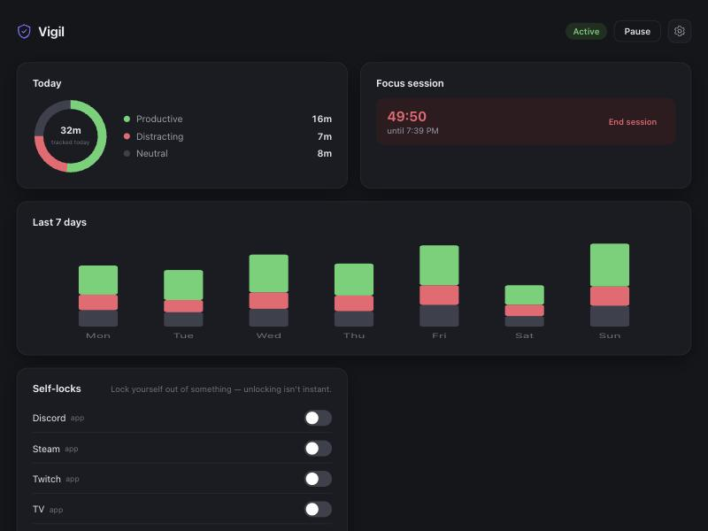

# Vigil

A visible, local focus assistant for macOS. It watches which app or website
is in front, classifies it as **productive**, **distracting**, or neutral
(anything not explicitly categorized — never tracked prominently, never
touched), and gives you two ways to block yourself from distractions:

- **Self-locks** — lock yourself out of one specific app or site,
  indefinitely, with a cooldown before an unlock actually takes effect.
- **Focus sessions** — block your whole distracting list for a set amount
  of time you choose up front.

Everything it does is visible on a local dashboard. Nothing is hidden, and
nothing leaves your machine — there's no account, no server, no telemetry.



## Why

Most blockers are either too strict (rigid schedules you fight against) or
too easy to disable (one click and you're back on the thing you were trying
to avoid). Vigil tries to sit in between: tracking is always honest about
what it sees, and the two blocking modes both use a short, deliberate
cooldown before an unlock takes effect — enough friction to stop an
impulsive "just for a second," not enough to be unusable.

## How it works

- `agent/tracker.py` polls the frontmost app every 5s via `osascript`. For
  browsers (Safari, Chrome, Arc, Brave, Edge) it also reads the active
  tab's URL to classify by domain.
- Everything is logged to `data/activity.db` (SQLite, local only).
- `dashboard/server.py` is a small JSON API (stdlib `http.server`, no
  dependencies) that the frontend in `dashboard/static/` talks to.
- `agent/config.json` holds your category lists — editable by hand, or
  from the dashboard's Settings panel.

Blocking works by quitting the app or redirecting the current browser tab
— it does not touch system-level network/DNS settings, so it needs no
`sudo` and no special entitlements, and can't survive a determined
`kill -9` on the tracker process. It's a strong nudge, not an unbreakable
cage — see Limitations below.

## Quickstart

```bash
git clone <this repo> vigil && cd vigil
python3 agent/tracker.py &
python3 dashboard/server.py
```

Open **http://localhost:8900**. The first run will prompt macOS for
permission for Terminal/python3 to control System Events and your
browser(s) — click **Allow** on each (manage later under System Settings →
Privacy & Security → Automation).

### Run at login (background service)

```bash
bash install/install.sh
```

Installs two LaunchAgents so the tracker and dashboard start automatically
at login and restart if they crash. To remove: `bash install/uninstall.sh`
(your data in `data/` is untouched).

## Configuring categories

Edit `agent/config.json`, or use the gear icon on the dashboard:

```json
"categories": {
  "productive": { "apps": [...], "domains": [...] },
  "distracting": { "apps": [...], "domains": [...] }
}
```

A domain entry matches that domain and any subdomain (`youtube.com` also
matches `m.youtube.com`). Anything not listed in either category is
**neutral** — tracked as background time but never nudged, blocked, or
singled out, so an editor, a terminal, or a work tool you haven't gotten
around to adding won't get caught by accident.

After editing by hand, restart the tracker to pick up changes:
`launchctl kickstart -k gui/$(id -u)/com.vigil.tracker` (if installed as a
service), or just re-run `python3 agent/tracker.py`. The dashboard reads
the config fresh on every request, so it needs no restart.

## Self-locks

Lock yourself out of one specific app or site from the dashboard, at any
time — this is separate from focus sessions below, and not tied to any
schedule.

- **Off → Locked**: tap the toggle. Enforced immediately, indefinitely —
  no duration to pick.
- **Locked → unlocking**: tap again to start turning it off. It doesn't
  unlock instantly — a cooldown (`early_unlock_cooldown_seconds` in
  config, default 5 min) runs first, so a moment of temptation can't undo
  the commitment. Tap again during the cooldown to cancel and stay locked.

Add anything not already in your distracting list with the field at the
bottom of the Self-locks card.

## Focus sessions

Pick 25/50/90 minutes (or any custom duration via the API) and start a
session — for that long, everything in your `distracting` category is
closed or redirected the moment it's opened, no grace period. Ending one
early isn't instant either: it uses the same cooldown as self-locks, so
getting out mid-session takes a deliberate, repeated choice, not a single
click in a weak moment.

## Limitations

- This only sees activity on **this Mac**. It has no concept of multiple
  user accounts — if several people share this login, tracking/blocking
  applies to whoever is using it.
- It's app/site blocking, not an OS-level screen lock. No `sudo`, no MDM
  profile — a technically determined person could force-quit the tracker
  process or switch to a different device. It's meant to raise the bar on
  casual distraction, not to be unbreakable.
- It's meant to be visible: the dashboard is always reachable, and every
  intervention fires a named "Vigil" notification rather than acting
  silently.

## Ideas for extending this

A few directions that would be natural next steps if you want to take this
further:

- **Weekly digest** — a once-a-week notification/email summarizing time
  split and self-lock activity, for reflection rather than real-time
  enforcement.
- **Streaks** — track consecutive days meeting a self-set "distracting
  time under X" goal, shown on the dashboard.
- **Per-category goals** — a simple daily target for productive time (like
  the original SAT-prep goal bar), generalized to any category.
- **Cross-platform tracker** — the AppleScript-based polling is macOS-only;
  a Windows/Linux tracker would need a different frontmost-window API
  (e.g. `pywin32` / `xdotool`) but could share the same dashboard and DB
  schema.
- **Browser extension instead of AppleScript** — more reliable tab/URL
  detection than polling via `osascript`, and could redirect without
  needing Automation permissions at all.
- **Export/import config** — a shareable "distraction list" JSON preset
  (e.g. "student," "deep work," "social media detox") people could drop
  in instead of building their category lists from scratch.

## License

MIT — see [LICENSE](LICENSE).
